## 2.2 Архитектура и модули приложения

Разрабатываемая платформа для управления автопарком построена по классической клиент-серверной архитектуре с использованием веб-технологий. На рисунке 2.1 представлена общая схема взаимодействия компонентов системы.

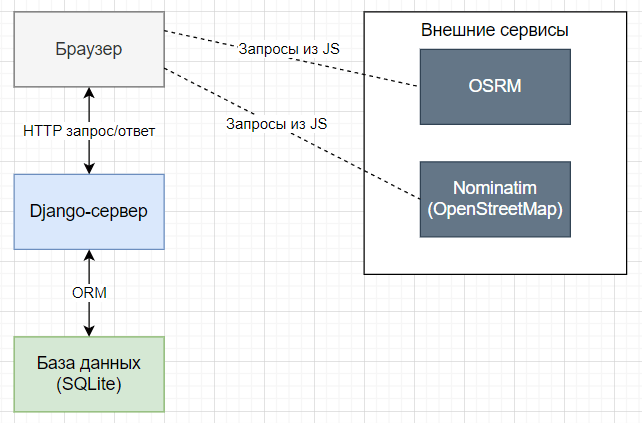

Рисунок 2.2 - Архитектура платформы (клиент-сервер)

**Компоненты архитектуры:**

1.  **Клиентская часть (Frontend).**

- Реализована на HTML5, CSS3 и JavaScript (ES6).
- Использует библиотеку Leaflet.js для отображения интерактивных карт, маркеров и маршрутов.
- Взаимодействует с сервером через стандартные HTTP-запросы (GET, POST) и AJAX (Fetch API) для асинхронного обновления данных (например, перемещение маркеров).
- Шаблоны Django (файлы .html) генерируются на сервере, но большая часть динамики (карта, построение маршрутов, перетаскивание маркеров) реализована на стороне клиента с помощью собственных JavaScript-скриптов (route_add.js, telemetry.js и др.).

1.  **Серверная часть (Backend).**

- Основана на фреймворке Django (Python), который реализует архитектурный паттерн MTV (Model-Template-View).
- Модели (Models) описывают структуру данных и связи между таблицами в реляционной базе данных (Vehicle, Driver, Route, FuelLog, Maintenance, Telemetry). Используется встроенный ORM Django для абстракции от конкретной СУБД.
- Представления (Views) содержат бизнес-логику: обработка HTTP-запросов, фильтрация и поиск, формирование контекста для шаблонов, а также AJAX-эндпоинты (например, обновление координат ТС).
- Шаблоны (Templates) — HTML-файлы с вкраплениями языка шаблонов Django, отвечающие за отображение списков, форм, карты и дашборда.
- URL-диспетчер (urls.py) маршрутизирует запросы к соответствующим view-функциям.
- Сигналы (signals.py) обеспечивают автоматическое обновление статуса транспортного средства при изменении связанных маршрутов или записей технического обслуживания.

1.  **База данных.**

- На этапе разработки используется SQLite (легковесная, файловая БД), что упрощает развертывание.
- В перспективе возможен переход на PostgreSQL для промышленной эксплуатации (лучшая поддержка конкурентности и расширений).
- Схема базы данных спроектирована в нотации «сущность-связь» и содержит шесть основных таблиц (см. раздел 2.1).

1.  **Внешние сервисы (API).**

- Nominatim (OpenStreetMap) – бесплатный геокодер. Используется для преобразования координат (широта, долгота) в почтовый адрес и обратно при создании маршрута.
- OSRM (Open Source Routing Machine) – сервис построения маршрутов. По координатам точек отправления и прибытия возвращает геометрию пути (GeoJSON) и расстояние в километрах. Запросы отправляются асинхронно из клиентского JavaScript, что не нагружает сервер Django.

**Модульная структура проекта Django:**

Проект организован в виде одного приложения (autopark_platform) со следующей модульной структурой:

- models.py – описание шести моделей данных.
- views.py – содержит все view-функции: для отображения списков (vehicle_list, driver_list, route_list, refuel_list, maintenance_list), форм добавления (vehicle_add, driver_add, route_add, refuel_add, maintenance_add), страницы телематики (telemetry) и дашборда (dashboard), а также AJAX-обработчик update_vehicle_location.
- urls.py – маршрутизация URL (например, /vehicles/, /drivers/, /routes/add/, /telemetry/, /telemetry/update_location/).
- signals.py – сигналы для обновления статуса ТС при сохранении/удалении маршрутов и ТО.
- apps.py – конфигурация приложения, подключение сигналов.
- admin.py – настройка административной панели Django (для удобного наполнения базы).
- Папка templates/ – содержит HTML-шаблоны: index.html, vehicle_list.html, driver_list.html, route_list.html, refuel_list.html, maintenance_list.html, telemetry.html, а также формы добавления (\*\_add.html).
- Папка static/css/ – файлы стилей (main.css).
- Папка static/js/ – клиентские скрипты (route_add.js, telemetry.js, refuel_add.js, maintenance_add.js, vehicle_add.js, driver_add.js).

**Особенности реализации модулей:**

**Модуль работы с картой и маршрутами.** Реализован в шаблоне route_add.html и скрипте route_add.js. При загрузке страницы инициализируется карта Leaflet. Пользователь последовательно кликает для выбора точек отправления и прибытия (маркеры). С помощью обратного геокодирования (Nominatim) подставляются почтовые адреса. Построение кратчайшего пути и расчёт расстояния выполняются через OSRM API. При выборе водителя из выпадающего списка автоматически подставляется привязанное к нему транспортное средство (через атрибуты data-vehicle-id).

**Модуль телематики.** Шаблон telemetry.html и скрипт telemetry.js отображают карту с маркерами всех ТС, координаты которых хранятся в базе. Маркеры могут быть перетащены; при отпускании отправляется AJAX-запрос на сервер (update_vehicle_location), который обновляет координаты ТС в таблице Vehicle. При клике на маркер определяется активный (если ТС в рейсе и есть незавершённый маршрут) или ближайший будущий маршрут, и на карте отрисовывается линия маршрута через OSRM.

**Модуль автоматического обновления статуса ТС.** Реализован в signals.py. Сигналы post_save и post_delete для моделей Route и Maintenance вызывают функцию update_vehicle_status, которая проверяет наличие незавершённого ТО (end_datetime IS NULL) или активного маршрута (departure_datetime <= now и arrival_datetime IS NULL), и, если статус изменился, сохраняет новое значение в поле status модели Vehicle.

**Модуль фильтрации и поиска.** Реализован в view-функциях и частично на клиенте (для vehicle_list.html, driver_list.html, route_list.html и др.). Параметры GET-запроса (например, search, status, route_status, sort_by) передаются в представление, где формируется отфильтрованный QuerySet. В шаблонах сохраняются текущие значения фильтров для подстановки в поля ввода и выпадающие списки.

Предложенная архитектура обеспечивает разделение ответственности, масштабируемость и удобство поддержки. Клиентская часть остаётся «лёгкой», основные вычислительные задачи (фильтрация, сортировка, сохранение данных) ложатся на сервер и базу данных, а интерактивная работа с картой выполняется браузером напрямую с внешними API, что снижает нагрузку на Django-сервер.

## 2.3 Разработка пользовательского интерфейса

Пользовательский интерфейс платформы управления автопарком представляет собой набор веб-страниц, каждая из которых является самостоятельным HTML-файлом.

Все страницы спроектированы в едином стиле с фиксированной боковой панелью (sidebar) и основной областью контента. Для стилизации используется общий файл main.css, для клиентской логики – отдельные JavaScript-файлы (например, telemetry.js, route_add.js, refuel_add.js, driver_add.js, vehicle_add.js, maintenance_add.js).

### 2.3.1 Общая структура страницы

Каждый HTML-шаблон (например, vehicle_list.html, driver_list.html, route_add.html, telemetry.html) имеет следующую структуру:

&lt;!DOCTYPE html&gt;

&lt;html lang="ru"&gt;

&lt;head&gt;

&lt;meta charset="UTF-8"&gt;

&lt;title&gt;Название раздела&lt;/title&gt;



&lt;link rel="stylesheet" href=""&gt;

_&lt;!-- дополнительные CSS (например, Leaflet) --&gt;_

&lt;/head&gt;

&lt;body&gt;

&lt;div class="app-container"&gt;

&lt;aside class="sidebar"&gt;

&lt;div class="logo"&gt;&lt;h2&gt;Автопарк&lt;/h2&gt;&lt;/div&gt;

&lt;nav class="tabs-nav"&gt;

&lt;a href="" class="tab-btn"&gt;Дашборд&lt;/a&gt;

&lt;a href="" class="tab-btn active"&gt;Весь транспорт&lt;/a&gt;

&lt;a href="" class="tab-btn"&gt;Водители&lt;/a&gt;

&lt;a href="" class="tab-btn"&gt;Маршруты&lt;/a&gt;

&lt;a href="" class="tab-btn"&gt;Информация о заправках&lt;/a&gt;

&lt;a href="" class="tab-btn"&gt;Техническое обслуживание&lt;/a&gt;

&lt;a href="" class="tab-btn"&gt;Телематика&lt;/a&gt;

&lt;/nav&gt;

&lt;/aside&gt;

&lt;main class="content"&gt;

_&lt;!-- уникальное содержимое страницы --&gt;_

&lt;/main&gt;

&lt;/div&gt;

_&lt;!-- подключение общих и специфичных скриптов --&gt;_

&lt;/body&gt;

&lt;/html&gt;

При переходе между разделами страницы перезагружаются полностью, но боковое меню остаётся визуально неизменным, что обеспечивает единообразие навигации. Активный пункт меню выделяется классом active, который устанавливается вручную в каждом шаблоне (например, на странице vehicle_list.html ссылка «Весь транспорт» имеет класс active).

### 2.3.2 Дашборд (главная страница)

Дашборд (index.html) является стартовой страницей и содержит сводную статистику по автопарку. Он разделён на несколько секций, оформленных в виде карточек. Статистика формируется в представлении dashboard и передаётся в шаблон через контекст. Пример отображения страницы «Дашборд» изображен на рисунке 2.3.
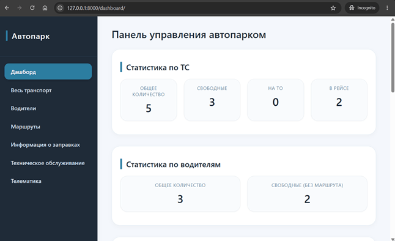

Рисунок 2.3 – Страница «Дашборд»

**Секция «Статистика по ТС»:** четыре карточки с числами (общее количество ТС, свободные, на ТО, в рейсе). Данные берутся из моделей Vehicle с фильтрацией по статусу.

**Секция «Статистика по водителям»:** общее количество водителей и количество свободных (не назначенных на маршрут).

**Секция «Статистика по маршрутам»:** общее количество маршрутов, выполняющиеся, завершённые, самый длинный маршрут. Ниже – таблица ближайших маршрутов (до 5 штук) с колонками: дата отправления, госномер ТС, уровень топлива, необходимость ТО, водитель.

**Секция «Статистика по заправкам»:** общая стоимость заправок, количество заправок, последняя цена за литр, а также список ТС с уровнем топлива менее 15 литров.

**Секция «Статистика по ТО»:** количество ТС, которым требуется ТО, общая стоимость всех ТО, списки ТС с приближающимся ТО по дате (в пределах 7 дней) и по пробегу (осталось ≤ 1000 км).

Все данные на дашборде обновляются при каждом заходе на страницу, так как представление выполняет запросы к базе данных в реальном времени.

### 2.3.3 Страницы списков (табличное представление)

Для каждой сущности (ТС, водители, маршруты, заправки, ТО) создана отдельная страница списка. Общие черты:

- **Заголовок** страницы (например, «Транспортные средства»).
- **Панель действий**: поле поиска, выпадающий список для фильтрации (по статусу, по ТС, по типу маршрута и т.п.), кнопка «Добавить» (ссылка на соответствующую форму добавления).
- **Таблица** с полями, соответствующими модели. Для маршрутов добавлены элементы управления сортировкой (по дате отправления, по кратчайшему пути).
- Если записей нет, выводится сообщение «Нет данных».
- Таблицы имеют горизонтальную прокрутку при малой ширине экрана.

**Страница «Весь транспорт» (**vehicle_list.html**):**

Таблица содержит столбцы: ID, марка, модель, госномер, статус, текущий пробег, год выпуска, VIN, уровень топлива, широта, долгота. Поиск осуществляется по марке, модели, госномеру, VIN с помощью GET-параметра search. Фильтр по статусу – выпадающий список со значениями free, on_route, on_maintenance и опцией «Все статусы». Кнопка «Добавить ТС» ведёт на vehicle_add.html. Пример отображения страницы «Весь транспорт» изображен на рисунке 2.4.
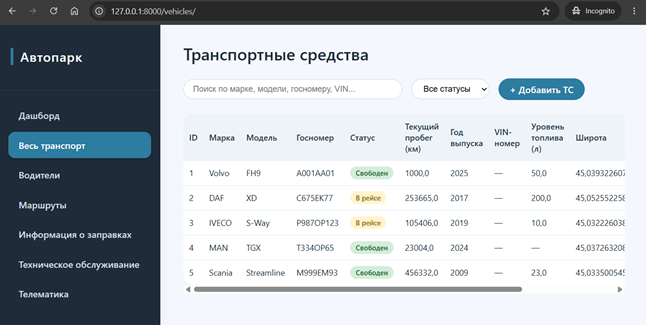

Рисунок 2.4 – Страница «Весь транспорт»

**Страница «Водители»** **(**driver_list.html**)** предназначена для просмотра и управления списком водителей. Она оформлена аналогично другим страницам списков: содержит заголовок, панель фильтрации и таблицу.

**Панель действий:**

- Поле поиска – позволяет искать водителей по ФИО, номеру водительского удостоверения, телефону и email (параметр GET search).
- Выпадающий список фильтрации по назначению ТС: «Все водители», «Назначен на ТС», «Свободен (без ТС)» (параметр assignment).
- Кнопка «Добавить водителя» – ведёт на форму driver_add.html.

Пример отображения страницы «Водители» изображен на рисунке 2.5.
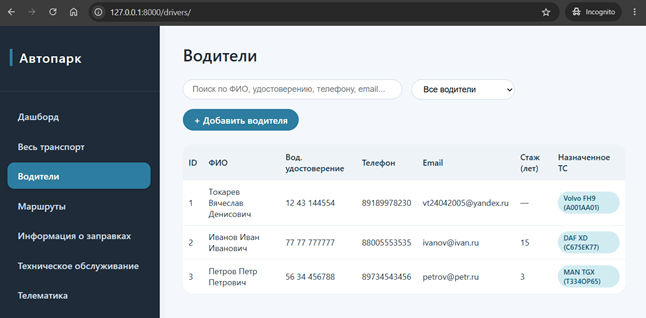

Рисунок 2.5 – Страница «Водители»

**Страница «Маршруты» (**route_list.html**):**

Дополнительные фильтры: статус маршрута (не начатые, выполняющиеся, завершённые). Сортировка по дате отправления (возрастание/убывание) и по кратчайшему пути. Для каждого маршрута отображаются координаты и адреса отправления/прибытия, дата/время, водитель и госномер ТС (через связь водитель → ТС). Статус маршрута вычисляется на основе departure_datetime, arrival_datetime и текущего времени и отображается цветным бейджем. Пример отображения страницы «Маршруты» изображен на рисунке 2.6.

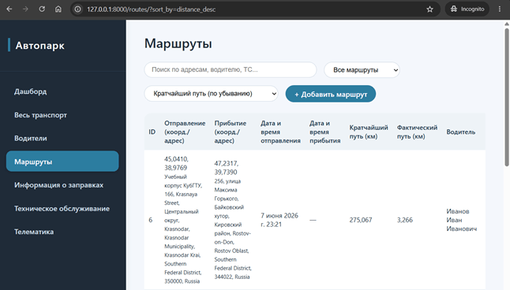

Рисунок 2.6 – Страница «Маршруты»

**Страницы «Информация о заправках» и «Техническое обслуживание»** (refuel_list.html, maintenance_list.html) содержат фильтрацию по конкретному ТС (выпадающий список) и, для ТО, специальные фильтры (по типу: все записи, ТС которым нужно ТО сейчас, скоро по дате, скоро по пробегу, на ТО). Эти фильтры реализованы через параметры GET-запроса и обрабатываются в соответствующих view-функциях. Примеры отображения страниц «Информация о заправках» и «Техническое обслуживание» изображены на рисунках 2.7 и 2.8 соответственно.

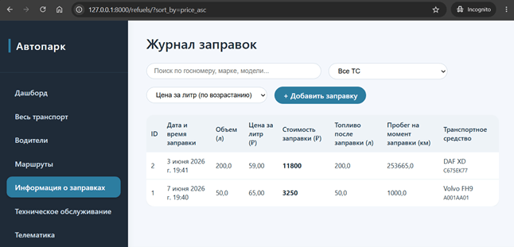

Рисунок 2.7 – Страница «Информация о заправках»

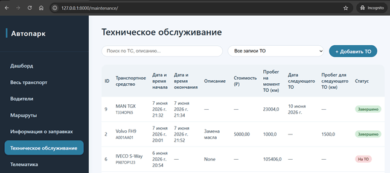

Рисунок 2.8 – Страница «Техническое обслуживание»

### 2.3.4 Формы добавления объектов

Формы добавления содержат поля, соответствующие моделям. Валидация выполняется как на стороне клиента (атрибуты required, типы number, email), так и на сервере (в view-функциях). После успешного сохранения пользователь перенаправляется на страницу списка с сообщением об успехе (через Django messages).

**Особенности формы добавления маршрута (**route_add.html**):**

- Включает интерактивную карту Leaflet.js. Пользователь последовательно кликами на карте устанавливает маркеры отправления и прибытия. При установке маркера координаты записываются в скрытые поля формы, а через обратный геокодер Nominatim автоматически подставляются почтовые адреса.
- Построение кратчайшего пути и расчёт расстояния выполняются через публичное API OSRM. Результат записывается в поле shortest_distance_km.
- Выбор водителя из выпадающего списка автоматически подставляет госномер закреплённого за ним ТС (используются HTML-атрибуты data-vehicle-id и data-vehicle-plate).
- Специфическая логика вынесена в отдельный файл static/js/route_add.js.

Пример отображения формы добавления маршрута изображен на рисунке 2.9.

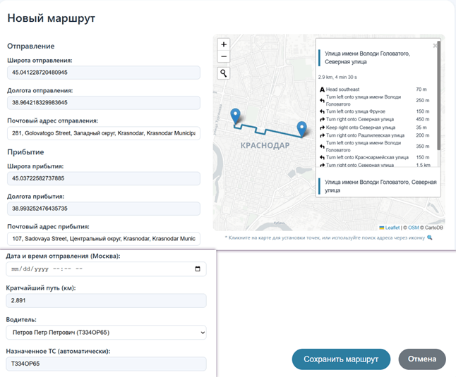

Рисунок 2.9 – Форма добавления маршрута

**Форма добавления заправки (**refuel_add.html**):**

- При выборе ТС из выпадающего списка с помощью JavaScript подгружаются текущий пробег (current_mileage) и уровень топлива (fuel_level) выбранного автомобиля (через атрибуты data-current-mileage и data-fuel-level).
- Поле «пробег на момент заправки» становится доступным только для чтения и автоматически заполняется.
- Поле «объём топлива после заправки» вычисляется как сумма текущего уровня топлива и введённого объёма. После сохранения заправки в базе данных обновляется поле fuel_level у соответствующего ТС (это делает представление refuel_add).

Пример отображения формы добавления заправки изображен на рисунке 2.10.

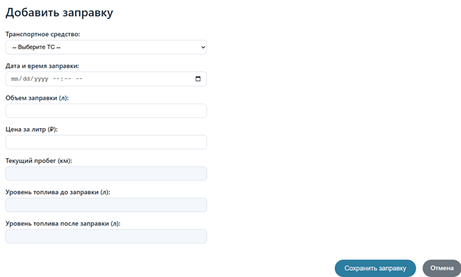

Рисунок 2.10 – Форма добавления заправки

**Форма добавления водителя (**driver_add.html**):**

Выпадающий список «Назначенное ТС» содержит только те транспортные средства, у которых поле driver равно NULL (свободные). Это реализовано в представлении через Vehicle.objects.filter(driver_\_isnull=True). Пример отображения формы добавления водителя изображен на рисунке 2.11.

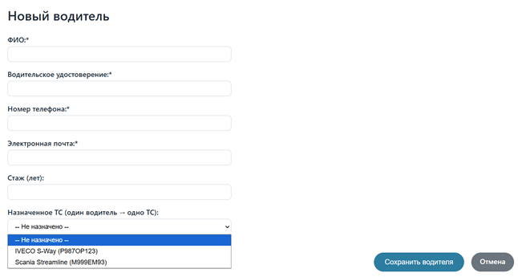

Рисунок 2.11 – Форма добавления водителя

**Форма добавления ТС (**vehicle_add.html**)** – стандартная форма со всеми полями модели Vehicle, включая опциональные VIN, уровень топлива, координаты. Статус выбирается из выпадающего списка на основе Vehicle.Status.choices. Пример отображения формы добавления ТС изображен на рисунке 2.12.

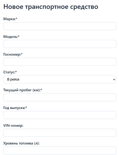

Рисунок 2.12 – Форма добавления ТС

**Форма добавления ТО (**maintenance_add.html**)** – содержит поля для дат, описания, стоимости. Пробег на момент ТО автоматически подставляется из current_mileage выбранного ТС (атрибут data-current-mileage). Поля следующего ТО (дата и пробег) являются необязательными. Пример отображения формы добавления ТО изображен на рисунке 2.13.

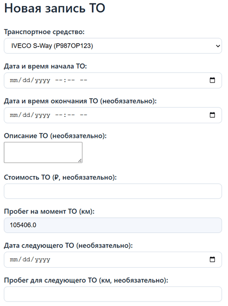

Рисунок 2.13 – Форма добавления ТО

### 2.3.5 Страница «Телематика»

Страница telemetry.html полностью посвящена отображению карты с метками транспортных средств. Её интерфейс:

- В верхней части – заголовок «Мониторинг транспорта в реальном времени».
- Ниже – контейнер для карты высотой 70% от видимой области.
- Под картой – легенда с цветовой индикацией статусов (зелёный – свободен, жёлтый – в рейсе, красный – на ТО).

Пример интерфейса страницы «Телематика» изображен на рисунке 2.14.

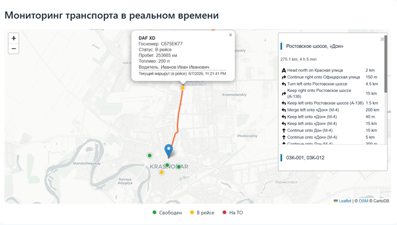

Рисунок 2.14 – Страница «Телематика»

Карта инициализируется с помощью Leaflet.js. На неё наносятся маркеры для всех ТС, у которых заданы координаты (или используются координаты Краснодара по умолчанию). Маркеры можно перетаскивать; при окончании перетаскивания отправляется AJAX-запрос на сервер (/telemetry/update_location/), который обновляет поля latitude и longitude в таблице Vehicle. При клике на маркер открывается попап с информацией о ТС (марка, модель, госномер, статус, пробег, уровень топлива, водитель), а также подробная информация о маршруте с основными отрезками пути. Если у ТС есть активный маршрут (для статуса «в рейсе») или ближайший будущий маршрут, то на карте отрисовывается линия маршрута, построенная через OSRM.

Весь клиентский код для телематики расположен в static/js/telemetry.js. Данные о ТС и их маршрутах передаются в шаблон через переменную vehicles_json, которая формируется в представлении telemetry с использованием json.dumps(..., default=str).

### 2.3.6 Единый стиль и адаптивность

Все страницы используют общий файл стилей main.css, в котором определены:

- Стили для бокового меню (.sidebar, .tab-btn, .active).
- Стили для карточек статистики (.stats-cards, .stat-card).
- Стили для таблиц (.data-table) и их адаптивной обёртки (.table-wrapper с overflow-x: auto).
- Стили для форм (.form-container, .field-group).
- Стили для уведомлений (.alert, .alert-error, .alert-success – через Django messages).
- Адаптивные медиа-запросы для экранов с шириной менее 800 пикселей.

Цветовая схема основана на синих акцентах (#2c7da0), светлом фоне (#f4f7fc) и нейтральных оттенках. Реализована поддержка четырёх тем (светлая, тёмная, закатная, лесная) с помощью CSS-переменных: при выборе темы JavaScript меняет класс на body, и переменные цвета переопределяются. Выбранная тема сохраняется в localStorage.

Разработанный интерфейс полностью покрывает все функциональные требования

Все страницы таблиц имеют поиск и фильтрацию, формы добавления содержат необходимую JavaScript-логику (карта, автоподстановки, вычисления), а страница телематики предоставляет наглядный геоинформационный сервис. Интерфейс адаптирован для различных размеров экрана и поддерживает смену тем оформления.

## 2.4 Интеграция GPS-трекинга и карт

Одной из ключевых особенностей разработанной платформы является использование интерактивных карт для визуализации местоположения транспортных средств, построения маршрутов и управления точками отправления/прибытия. Для этого были выбраны библиотека Leaflet.js, сервис маршрутизации OSRM (Open Source Routing Machine) и геокодер Nominatim (на базе OpenStreetMap). Интеграция реализована как в форме добавления маршрута (route_add.html), так и на странице телематики (telemetry.html). В данном разделе рассматриваются технические аспекты интеграции, включая инициализацию карты, обработку событий, обмен данными с внешними API и передачу данных между Django и JavaScript.

### 2.4.1 Выбор технологий

**Leaflet.js** – лёгкая библиотека с открытым исходным кодом, позволяющая создавать мобильные и десктопные интерактивные карты. Она поддерживает растровые и векторные слои, маркеры, всплывающие окна, линии, полигоны и имеет большое количество плагинов. Основные преимущества: малый вес (около 39 КБ), бесплатное использование без API-ключей, понятный API и хорошая документация. Для платформы были выбраны следующие плагины Leaflet:

- Leaflet Control Geocoder – обеспечивает поиск адресов и обратное геокодирование.
- Leaflet Routing Machine – строит маршруты между двумя точками, отображает пошаговые инструкции, расстояние и расчётное время.

**OSRM** – высокопроизводительный движок маршрутизации, использующий данные OpenStreetMap. Публичное API (https://router.project-osrm.org) позволяет отправлять HTTP-запросы с координатами точек и получать геометрию маршрута в формате GeoJSON, расстояние в метрах и время в секундах. Сервис не требует аутентификации и удобен для учебных проектов.

**Nominatim** – геокодер на основе OpenStreetMap. Используется для преобразования координат в почтовый адрес (обратное геокодирование) и для поиска адресов по тексту (прямое геокодирование). Запросы выполняются по протоколу HTTPS, ответ возвращается в формате JSON.

### 2.4.2 Интеграция карты в форму добавления маршрута

Шаблон route_add.html содержит контейнер для карты с идентификатором map, а также скрытые поля для координат и адресов. После загрузки страницы инициализируется карта с центром по умолчанию (Москва, Краснодар или другой город). Подключается слой тайлов OpenStreetMap (CartoDB Light). Далее настраиваются обработчики событий.

**Последовательность действий пользователя при создании маршрута:**

1.  Клик на карте – устанавливается первый маркер (отправление). Координаты записываются в поля departure_latitude и departure_longitude.
2.  Клик на карте – устанавливается второй маркер (прибытие). Координаты записываются в поля arrival_latitude и arrival_longitude.
3.  Автоматически выполняется обратный геокодинг (запрос к Nominatim) для определения почтового адреса каждой точки, результат подставляется в поля departure_address и arrival_address.
4.  После установки обеих точек отправляется запрос к OSRM:  
    https://router.project-osrm.org/route/v1/driving/{lng1},{lat1};{lng2},{lat2}?overview=full&geometries=geojson.
5.  Полученное расстояние (в километрах) записывается в поле shortest_distance_km, а линия маршрута отображается на карте.
6.  Пользователь выбирает водителя из выпадающего списка; JavaScript подхватывает атрибуты data-vehicle-id и data-vehicle-plate, автоматически подставляя госномер ТС в соответствующее поле формы.
7.  Форма отправляется на сервер, где создаётся объект Route.

**Реализация в коде (фрагмент** route_add.js**):**

map.on('click', function(e) {

if (!markerStart) setStartPoint(e.latlng.lat, e.latlng.lng);

else if (!markerEnd) setEndPoint(e.latlng.lat, e.latlng.lng);

else setEndPoint(e.latlng.lat, e.latlng.lng); _// перезапись_

});

async function setStartPoint(lat, lng) { ... }

async function setEndPoint(lat, lng) { ... }

Геокодер добавляется на карту через L.Control.geocoder, и при выборе адреса из выпадающего списка вызывается аналогичная установка маркера.

### 2.4.3 Страница телематики: отображение транспортных средств и активных маршрутов

Страница telemetry.html предназначена для диспетчерского контроля. На карту наносятся маркеры всех транспортных средств, у которых заданы координаты (если координаты отсутствуют, используются координаты Краснодара по умолчанию). Цвет маркера соответствует статусу ТС: зелёный – свободен, жёлтый – в рейсе, красный – на ТО.

При клике на маркер открывается всплывающее окно с информацией: марка, модель, госномер, статус, пробег, уровень топлива, водитель. Если для данного ТС существует активный маршрут (для статуса «в рейсе» – маршрут с departure_datetime <= now и arrival_datetime IS NULL) или ближайший будущий маршрут, то на карте строится линия этого маршрута и отображается панель с пошаговыми инструкциями (Leaflet Routing Machine). Данные о маршруте для каждого ТС формируются в представлении telemetry и передаются в шаблон в виде JSON.

**Передача данных из Django в JavaScript:**

В views.py функция telemetry формирует список словарей vehicles_data, содержащий для каждого ТС идентификатор, марку, модель, координаты, статус, а также вложенный объект next_route с координатами отправления и прибытия. Затем список преобразуется в JSON-строку с помощью json.dumps(..., default=str) и передаётся в контексте:

vehicles_json = json.dumps(vehicles_data, ensure_ascii=False, default=str)

return render(request, 'telemetry.html', {'vehicles_json': vehicles_json})

В шаблоне данные встраиваются в глобальную переменную:

&lt;script&gt; const vehiclesData = {{ vehicles_json|safe }}; &lt;/script&gt;

После этого telemetry.js обрабатывает vehiclesData, создаёт маркеры и привязывает события.

**Особенности отрисовки маршрута на странице телематики:**

Функция drawRoute(startLat, startLng, endLat, endLng, isActive) создаёт экземпляр L.Routing.control с опциями show: true (панель видна) и collapsible: true (можно свернуть). Цвет линии зависит от флага isActive: оранжевый для активного маршрута (в рейсе), синий для будущего. Панель маршрута содержит подробные указания: расстояние, расчётное время, маневры на каждом перекрёстке. При повторном открытии попапа старый маршрут удаляется с карты, а новый строится заново.

### 2.4.4 Работа с геокодером и обратным геокодированием

Для формы добавления маршрута реализованы две взаимодополняющие возможности:

- **Прямое геокодирование** – пользователь вводит адрес в поле поиска (например, «Краснодар, ул. Красная, 35»). Плагин L.Control.geocoder отправляет запрос к Nominatim, получает координаты и центрирует карту на найденной точке, устанавливая маркер.
- **Обратное геокодирование** – при клике на карту (или перетаскивании маркера) координаты отправляются к https://nominatim.openstreetmap.org/reverse, и полученный адрес подставляется в текстовое поле формы. Это позволяет сохранять не только координаты, но и понятный человеку адрес.

Обратный геокодирование выполняется асинхронно с помощью fetch. В целях соблюдения политики использования Nominatim добавлена задержка между запросами (на практике используется setTimeout или обработка через Promise).

### 2.5.5 Перемещение маркеров на карте телематики

На странице телематики маркеры транспортных средств сделаны перетаскиваемыми (опция draggable: true). При окончании перетаскивания срабатывает событие dragend, которое отправляет AJAX-запрос на сервер (эндпоинт /telemetry/update_location/) с новыми координатами. Представление update_vehicle_location обновляет поля latitude и longitude в модели Vehicle. Для защиты от CSRF в запросе передаётся токен из куки.

fetch('/telemetry/update_location/', {

method: 'POST',

headers: {'Content-Type': 'application/json', 'X-CSRFToken': getCookie('csrftoken')},

body: JSON.stringify({vehicle_id: id, latitude: lat, longitude: lng})

});

Интеграция Leaflet.js, OSRM и Nominatim позволила реализовать полноценный геоинформационный функционал: выбор точек маршрута на карте с автоматическим определением адреса, построение кратчайшего пути, отображение активных маршрутов на странице телематики и ручное перемещение маркеров.
